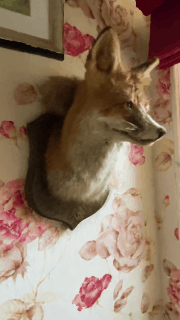
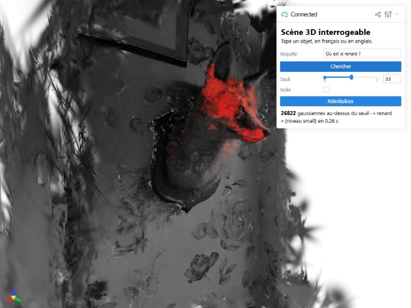
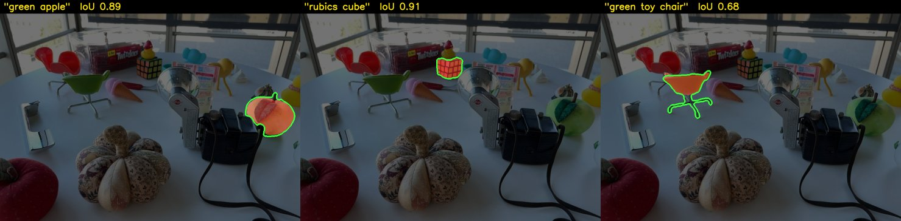
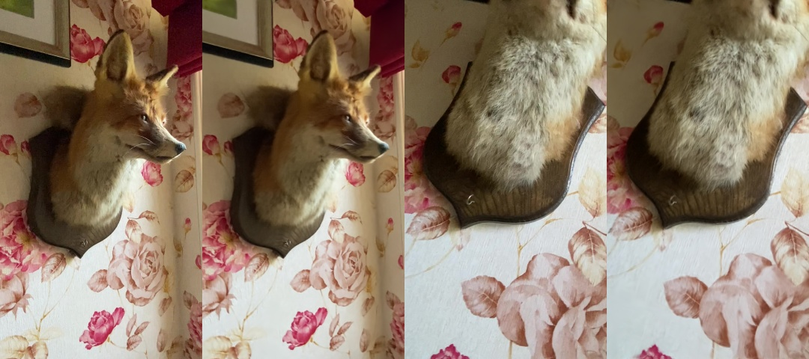
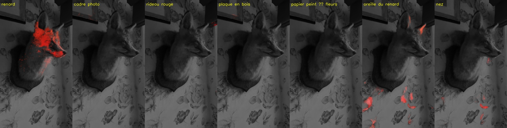
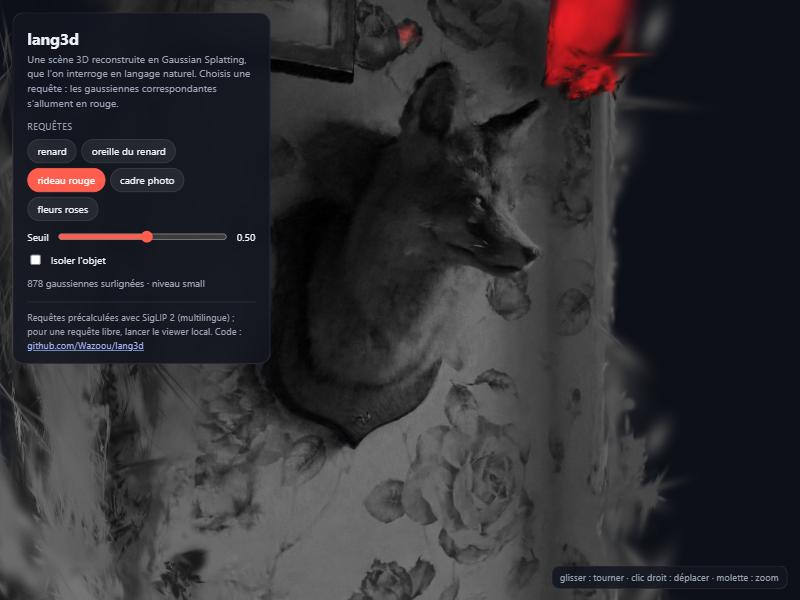

# lang3d — Scène 3D interrogeable en langage naturel

[](https://github.com/Wazoou/lang3d/actions/workflows/tests.yml)

À partir d'une simple vidéo filmée au téléphone, lang3d reconstruit la scène en
**Gaussian Splatting** et attache à chaque gaussienne un **embedding
vision-langage** (SigLIP 2). On peut ensuite taper « où est la chaise rouge ? »
dans un viewer web et voir l'objet surligné en 3D.

Approche inspirée de [LERF](https://www.lerf.io/) et
[LangSplat](https://langsplat.github.io/), adaptée pour tourner sur un GPU
grand public (RTX 2070, 8 Go).





## Évaluation sur le benchmark LERF

Benchmark de référence du domaine : dataset LERF annoté par les auteurs de
LangSplat (`lerf_ovs`), avec **leur protocole d'évaluation reproduit à
l'identique** ([evaluate.py](lang3d/evaluate.py)) et leurs poses COLMAP.
Scène évaluée : **figurines** (4 vues annotées, 56 requêtes en anglais).

| figurines | Localisation (%) | IoU moyen (%) |
|---|---|---|
| LERF (Kerr et al., ICCV 2023) | 75,0 | 38,6 |
| LangSplat (Qin et al., CVPR 2024) | 80,4 | 44,7 |
| **lang3d** | **83,9** | **49,0** |
| lang3d, option *objet entier* | 83,9 | 52,9 |



*Contour vert : masque annoté à la main. Rouge : masque prédit. Images : dataset LERF.*

**Comment lire ces chiffres :**
- *Localisation* : le point le plus pertinent de la carte tombe-t-il dans la boîte de l'objet ? *IoU* : recouvrement entre la zone prédite et le masque annoté.
- **Contrôle** : en mélangeant les requêtes entre les objets d'une même image, les scores tombent à 1,7 % (IoU) et 1,8 % (localisation). L'évaluation mesure donc bien la compréhension des requêtes.
- Le chiffre principal utilise les réglages par défaut, fixés avant l'évaluation. L'option *objet entier* est donnée à titre indicatif : la choisir après avoir vu les scores reviendrait à régler la méthode sur le jeu de test.
- **Une seule scène** sur les quatre du benchmark : les chiffres LERF / LangSplat ci-dessus sont ceux de la même scène, pas leur moyenne.
- Conditions différentes : LangSplat utilise une RTX 3090, 30 000 itérations, SAM ViT-H et OpenCLIP ; lang3d une RTX 2070, 7 000 itérations, SAM ViT-B et SigLIP 2, sans entraînement des features. Le gain vient probablement en partie de SigLIP 2, plus récent que CLIP.
- Échecs typiques : petits objets et noms propres (« pirate hat », « pumpkin », « miffy ») ; objets fins (les pieds de la chaise).

Pour reproduire (après avoir téléchargé `lerf_ovs` depuis le README de LangSplat dans `data/`) :

```bash
SCENES=figurines bash scripts/run_lerf.sh
```

## Résultats sur la scène « fox » (instant-ngp, 50 photos)

| Étape | Temps (RTX 2070) | Résultat |
|---|---|---|
| Poses VGGT | 18 s | 50 caméras, 200 k points, 7,1 Go VRAM max |
| Gaussian Splatting | 3 min 43 s (7000 itérations, 540×960) | 419 k gaussiennes, PSNR entraînement 29,7 dB ; sur 7 vues jamais vues (`--test-every 8`) : 24,8 dB, **25,1 dB avec la profondeur VGGT** |
| SAM + SigLIP 2 | 3 min | 4127 masques (83 par image) |
| Lifting 2D → 3D | 16 s (2 niveaux) | 402 k gaussiennes avec une feature, SVD 768 → 128 dims (98,3 % de l'énergie) |
| Requête | 0,02 à 0,3 s | |

Rendu (droite) vs photo d'origine (gauche) :



Requêtes en français (gaussiennes au-dessus du seuil en rouge) :



- ✅ « renard », « oreille du renard » (pointes des oreilles), « cadre photo » (en bord de vue)
- ✅ « rideau rouge » avec l'option *objet entier* (1080 gaussiennes, tout le rideau ; 168 sans)
- ❌ « papier peint à fleurs », « plaque en bois » : seuls quelques fragments ressortent (voir limites)

## Résultats sur une vidéo de téléphone

Vidéo 4K de 25 s en tournant autour d'une gourde posée sur du carrelage (non publiée) :

| Étape | Résultat |
|---|---|
| Frames | 40 images 720×1280 en 22 s |
| Poses VGGT | tour complet (~360°) reconstruit, 6,6 Go VRAM |
| Gaussian Splatting | 5 min 17 s, 797 k gaussiennes, PSNR entraînement 35,6 dB |

- ✅ « gourde violette » (isolée parfaitement, rien d'autre ne s'allume), « chaussures », « couvercle »
- ❌ « carrelage », « parquet », « mur blanc » : même limite que les fonds texturés
- Le choix des mots compte : « bouchon » échoue (compris comme un bouchon de liège), « couvercle » réussit

Ce test a révélé un bug invisible sur les images de fox : les téléphones stockent la
vidéo couchée avec une métadonnée de rotation qu'OpenCV 4.11 n'applique pas par défaut.

## Ce qui a été essayé

Chaque idée a été mesurée sur fox (nombre de gaussiennes surlignées + vérification visuelle) avant d'être gardée.

| Essai | Résultat | Décision |
|---|---|---|
| Un seul niveau (plus petit masque SAM par pixel) | Parties d'objets OK, mais les grands objets sont morcelés | → deux niveaux |
| Deux niveaux `small` / `large` (comme LangSplat), meilleur niveau choisi par requête | « cadre photo » et « rideau rouge » passent au niveau `large` | ✅ gardé, niveau forçable dans le viewer |
| Zones non couvertes par SAM ajoutées comme masques | Le fond (29 % de l'image) a enfin une feature | ✅ gardé |
| Fond encodé par des carrés intérieurs plutôt qu'un crop troué | Aucun gain : le score reste au niveau du négatif « texture » | ❌ retiré |
| Ensemble de prompts (« {} », « une photo de {} », « a photo of {} ») | Objets : « rideau rouge » 168 → 1080. Parties : « oreille du renard » surligne tout le renard | ⚖️ option *objet entier*, désactivée par défaut |
| Retirer le négatif « texture » pour les surfaces | Aucun gain visible sur « carrelage », « parquet », « mur blanc » | ❌ non intégré |
| Profondeur VGGT dans la perte d'entraînement (poids 0,1), 3 runs par configuration, 7 vues de test | PSNR test 24,81 ± 0,18 → **25,14 ± 0,04 dB** ; les 3 runs avec dépassent les 3 sans ; entraînement plus stable | ✅ activée par défaut quand la profondeur est disponible |

## Pipeline

```
vidéo ──► frames ──► VGGT ──► Gaussian Splatting ──┐
                    (poses +    (gsplat)           │
                    points)                         ▼
          frames ──► SAM ──► SigLIP 2 ──► lifting 2D→3D ──► viewer web + requêtes texte
                    (masques)  (1 embedding    (astuce du gradient)
                                par masque)
```

| Étape | Module | Ce qui se passe |
|---|---|---|
| 1. `frames` | [frames.py](lang3d/frames.py) | Découpe la vidéo, garde l'image la plus nette de chaque fenêtre (variance du Laplacien). |
| 2. `poses` | [poses.py](lang3d/poses.py) | **VGGT** (Meta, CVPR 2025) prédit en une passe les caméras et une profondeur par image ; on en tire le nuage de points initial. |
| 3. `train` | [train.py](lang3d/train.py) | **3D Gaussian Splatting** avec gsplat : perte L1 + D-SSIM + profondeur VGGT, densification adaptative, harmoniques sphériques progressives. |
| 4. `features` | [features.py](lang3d/features.py) | **SAM** découpe chaque image en masques (+ les zones non couvertes) ; chaque masque est encodé par **SigLIP 2** (multilingue). Deux niveaux : plus petit masque par pixel (parties) et plus grand (objets entiers). |
| 5. `lift` | [lift.py](lang3d/lift.py) | Report des embeddings sur les gaussiennes **sans entraînement** (voir ci-dessous). |
| 6. `view` / `query` | [viewer.py](lang3d/viewer.py), [query.py](lang3d/query.py) | Score de pertinence façon LERF, surbrillance dans un viewer web (viser) ou export `.ply`. |
| 7. `demo` | [demo.py](lang3d/demo.py) | GIF le long de la trajectoire filmée (caméras interpolées), scène puis requête surlignée. |

## Les idées clés

**Lifting 2D → 3D par le gradient.** Le rendu d'un pixel est linéaire en la
« couleur » des gaussiennes : `rendu(p) = Σᵢ wᵢₚ · cᵢ` avec `wᵢₚ = αᵢ · Tᵢ`.
Le gradient de `Σₚ ⟨rendu(p), F(p)⟩` par rapport à `cᵢ` vaut donc exactement
`Σₚ wᵢₚ · F(p)` : la moyenne (non normalisée) des features des pixels que la
gaussienne couvre. **Un seul rendu + backward par image** suffit, là où LangSplat
entraîne un autoencodeur puis optimise les features pendant des milliers d'itérations.

**Compression qui préserve les requêtes.** Les embeddings (768 dims) sont
projetés sur une base obtenue par SVD *non centrée* des embeddings de la
scène. Le produit scalaire avec le texte est préservé (`⟨t, f⟩ ≈ ⟨Pᵀt, Pᵀf⟩`),
contrairement à l'autoencodeur 3D de LangSplat.

**Pertinence relative (LERF).** Un cosinus brut ne veut rien dire seul. On
compare la requête à des négatifs génériques (« object », « things »,
« stuff », « texture ») : `min_j sigmoid(τ · (⟨f,q⟩ − ⟨f,n_j⟩))`.

**Requêtes en français.** SigLIP 2 a un tokenizer multilingue
(similarité « renard » / « fox » : 0,95), et les tournures du type
« où est la… ? » sont retirées avant l'encodage.

## Installation (Windows, GPU NVIDIA)

```bash
git clone https://github.com/Wazoou/lang3d.git && cd lang3d
uv venv .venv --python 3.10
uv pip install --python .venv/Scripts/python.exe -r requirements.txt --index-strategy unsafe-best-match
uv pip install --python .venv/Scripts/python.exe --no-deps "vggt @ git+https://github.com/facebookresearch/vggt"
```

Python 3.10 est imposé par la wheel gsplat précompilée pour Windows (pas besoin
du CUDA Toolkit ni de Visual Studio). Optionnel : `pip install -e .` installe la
commande `lang3d` (équivalente à `python -m lang3d`).

## Utilisation

```bash
python -m lang3d frames   scenes/salon --video salon.mp4
python -m lang3d poses    scenes/salon
python -m lang3d train    scenes/salon
python -m lang3d features scenes/salon
python -m lang3d lift     scenes/salon
python -m lang3d view     scenes/salon        # → http://localhost:8080
python -m lang3d query    scenes/salon "où est la chaise rouge ?"   # export .ply
python -m lang3d demo     scenes/salon "où est la chaise rouge ?"   # → docs/demo.gif
```

Avec des poses COLMAP existantes (dataset avec `sparse/0/`), remplacer `poses`
par `python -m lang3d colmap <scène>`. Évaluation : `python -m lang3d evaluate data/lerf_ovs --scenes figurines`.

Options de requête (viewer et `query`) :
- **Niveau** (`--level small|large`) : `small` pour une partie d'objet (« oreille »), `large` pour un objet entier ; par défaut, le plus pertinent.
- **Objet entier** (`--objet-entier`) : ensemble de prompts, mieux pour les objets, moins bien pour les parties.
- **Seuil** et **Isoler** (viewer) : régler la sélection et masquer le reste de la scène.
- **Sélectionner en cliquant** (viewer) : cliquer sur un objet surligne tout ce qui lui ressemble, sans taper de texte (requête par l'exemple, à partir du vecteur de sens de la gaussienne cliquée).

Pour un dossier d'images existant, mettre les images dans `scenes/<nom>/images/`
et commencer à l'étape `poses`.

Conseils de capture : 30 à 60 s, tourner lentement autour de la scène, éviter
le flou, les reflets et les zones très sombres.

## Démo web statique

```bash
python -m lang3d export-web scenes/fox "renard" "oreille du renard" "rideau rouge" "cadre photo" "fleurs roses"
python -m http.server 8765 --directory docs/demo     # → http://localhost:8765
```



`export-web` produit une page autonome dans `docs/demo/` : les gaussiennes au format
`.splat` (250 000 au maximum, ~8 Mo), un score par gaussienne et par requête
précalculée, et un viewer [gsplat.js](https://github.com/huggingface/gsplat.js)
chargé depuis un CDN. Aucun serveur Python ni GPU n'est nécessaire pour la
consulter : elle peut être publiée telle quelle avec GitHub Pages
(*Settings → Pages → Branch `main`, dossier `/docs`*), à l'adresse
`https://<utilisateur>.github.io/lang3d/demo/`. SigLIP 2 ne tourne pas dans le
navigateur : pour une requête libre, il faut le viewer local.

## Tests

```bash
python -m pytest -q
```

19 tests : nettoyage des requêtes, lecteur COLMAP, protocole d'évaluation
(lissage identique à celui de LangSplat), sélection des frames nettes, géométrie
du padding VGGT, sélection au clic, format `.splat` et rotations de la démo web,
et l'astuce du gradient (sur GPU uniquement).
Ils tournent automatiquement sur GitHub Actions (Linux, CPU) à chaque push.

## Limites connues

- VGGT tient environ 40 à 50 images sur 8 Go de VRAM : moins de vues que COLMAP, donc un splatting moins net hors des points de vue filmés.
- Grands fonds texturés (papier peint, sol) : SAM ne les segmente pas d'un bloc, et même une fois encodés, leur similarité avec « papier peint à fleurs » (~0,07–0,10) ne dépasse pas celle du négatif « texture » (~0,09). Le score LERF les neutralise donc par construction.
- Objets en grande partie cachés (la plaque derrière la tête du renard) : leurs crops sont trop petits pour être reconnus.
- Requêtes très courtes et sans contexte (« les oreilles ») : moins fiables que « oreille du renard ».
- COLMAP n'est pas utilisable ici : Smart App Control (Windows) bloque la DLL non signée de pycolmap.
- Poids VGGT-1B sous licence non commerciale.

Suivi d'avancement : [TODO.md](TODO.md).
